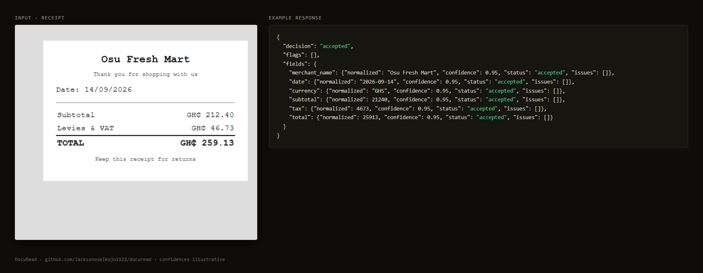
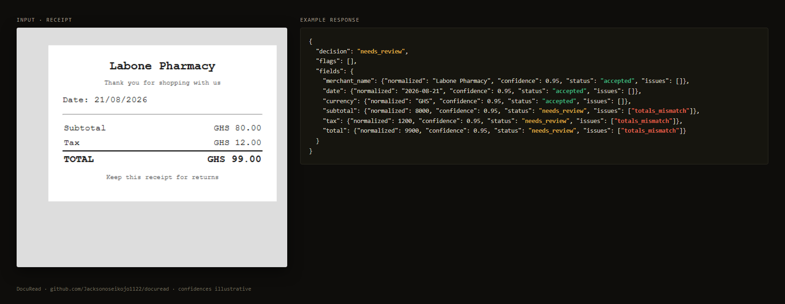

# Getting started

This takes about five minutes. You need Node.js 20+ and an Anthropic API key.

## 1. Install and run

```bash
git clone https://github.com/Jacksonoseikojo1122/docuread.git
cd docuread
npm install
cp .env.example .env
```

Open `.env` and set:

```bash
ANTHROPIC_API_KEY=sk-ant-...      # from console.anthropic.com
DOCUREAD_API_KEYS=my-secret-key   # what your app will send; use a long random string
```

Start it:

```bash
npm run dev
# DocuRead listening on http://localhost:8787
```

## 2. Send your first document

The repo ships with sample documents in `eval/fixtures`. Try one:

```bash
curl -X POST http://localhost:8787/v1/extract \
  -H "Authorization: Bearer my-secret-key" \
  -F type=receipt \
  -F file=@eval/fixtures/receipt-gh-supermarket.png
```

You get back every field with what the model read, the cleaned-up value, its confidence and whether it was accepted:



## 3. Read the decision

Look at `decision` first:

| `decision` | What it means | What your app should do |
| --- | --- | --- |
| `accepted` | Every field was confident and passed every check | Use `fields[*].normalized` |
| `needs_review` | At least one field was doubtful or failed a check | Show it to a person (it's already in the review queue) |
| `rejected` (HTTP 422) | The model declined or returned nothing usable | Ask the user to re-upload, or send it to a person |

Then, for each field, `status` and `issues` tell you exactly what was wrong:



Here the model read every number correctly, but 80.00 + 12.00 is not 99.00. A confident model can't fix a document that is wrong, so DocuRead sends it to a person.

## 4. Clear the review queue

```bash
# What's waiting?
curl -H "Authorization: Bearer my-secret-key" "http://localhost:8787/v1/review?status=pending"

# A person checked it: the real total was 92.00
curl -X POST -H "Authorization: Bearer my-secret-key" -H "Content-Type: application/json" \
  -d '{"corrections": {"total": "92.00"}}' \
  http://localhost:8787/v1/review/<id>/resolve
```

## Next

- [Integrate it into your app](integration.md): Node/TypeScript, Python and browser uploads
- [How it works](how-it-works.md): the rules, the threshold, and what happens to your documents
- [Evals](evals.md): measure accuracy and catch regressions
- [API reference](../openapi.yaml): the full OpenAPI spec
