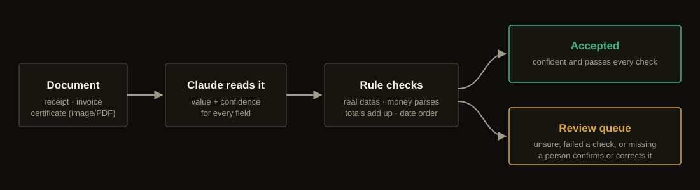

# How DocuRead works

## 1. Claude reads the document

DocuRead sends the image or PDF to Claude with a list of fields to copy out, and asks for a structured answer: for every field, the value **as printed** and a confidence between 0 and 1. Structured output means the reply always matches the expected shape; there's no free text to parse.

The instructions tell the model to copy, not calculate: if a field isn't on the page, return null rather than guess. A wrong value with high confidence is called out as the worst outcome.

If the model declines to read a document for policy reasons, the request is retried automatically on a fallback model in the same call. If that also declines, you get HTTP 422 and the document should go to a person.

## 2. Code checks the answer

The model's answer is treated as untrusted input. Every field is parsed and checked:

| Check | Example it catches |
| --- | --- |
| Dates must be real calendar dates in `YYYY-MM-DD` | `2026-02-30`, `14/09/2026` |
| Money must parse as a plain amount | `GH₵259.13`, `1.234` |
| Currency must be a known ISO 4217 code | `cedis`, `$$` |
| Required fields must be present | A receipt with no total |
| `subtotal + tax = total` (to within one pesewa/cent) | 80.00 + 12.00 printed as 99.00 |
| Invoices: due date on or after issue date | Due 10 Sep, issued 20 Sep |
| Certificates: expiry after issue date | Expiry before issue |
| Certificates: expiry in the past | Raised as the `expired` flag, not as a review |

Money is converted to integer minor units, so `259.13` becomes `25913`. Totals compare exactly and there's no floating-point rounding.

## 3. Doubtful fields go to review

A field is `accepted` only if it passed every check **and** its confidence is at or above the threshold (`DOCUREAD_THRESHOLD`, default `0.85`). Otherwise it's `needs_review` with a list of `issues`.

If any field needs review, the whole document's `decision` is `needs_review` and it's added to the review queue. A missing optional field (like `customer_name` on an invoice that has none) is a correct answer, not a doubtful one, so it doesn't trigger review.

## Choosing the threshold

- **Higher (0.9+)**: more goes to review, fewer mistakes get through. Use it for money you pay out, licences and IDs.
- **Lower (0.7)**: less manual work, more risk. Fine for expense categorisation.

Run the [eval](evals.md) after changing it: it reports how many wrong fields were accepted (silent errors) and how many documents went to review, so you can see the trade-off in numbers.

## What happens to documents

DocuRead doesn't save the uploaded file. For documents that need review, it saves the extracted fields and the model's note in the review store, so a person can check them. The document itself is sent to the Anthropic API for reading; check that this fits your data-protection obligations before sending personal documents.
