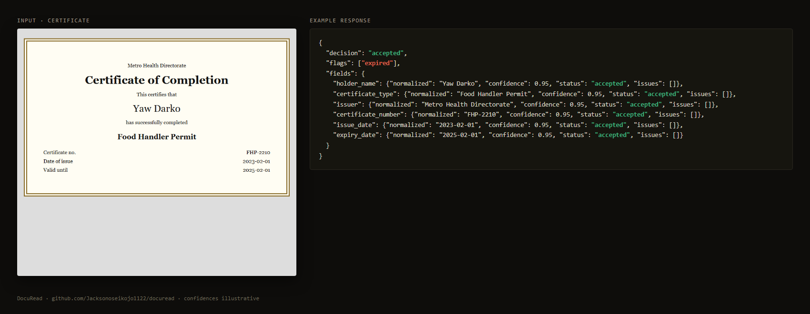

# Integrating DocuRead into your app

DocuRead is a small HTTP service. Run it next to your app (or on its own server) and call it whenever a user uploads a document. Your app never needs the Anthropic key; only DocuRead does.

```
your app ──(file + type)──▶ DocuRead ──▶ Claude
    ▲                          │
    └──── decision + fields ◀──┘   doubtful? ──▶ review queue ──▶ a person
```

## The one rule

**Only store `normalized` values from fields whose `status` is `accepted`.** Everything else either waits for a person or is shown to the user to confirm. That rule is the whole point: it keeps confidently wrong answers out of your database.

## Node.js / TypeScript

```ts
// docuread.ts
type Field = {
  value: string | null;
  normalized: string | number | null;
  confidence: number;
  status: "accepted" | "needs_review";
  issues: string[];
};
type Result =
  | { id: string; decision: "accepted" | "needs_review"; fields: Record<string, Field>; flags: string[]; notes: string }
  | { id: string; decision: "rejected"; reason: string };

const DOCUREAD_URL = process.env.DOCUREAD_URL ?? "http://localhost:8787";
const DOCUREAD_KEY = process.env.DOCUREAD_KEY!;

export async function readDocument(file: Blob, type: "receipt" | "invoice" | "certificate"): Promise<Result> {
  const form = new FormData();
  form.set("type", type);
  form.set("file", file);
  for (let attempt = 0; attempt < 3; attempt++) {
    const res = await fetch(`${DOCUREAD_URL}/v1/extract`, {
      method: "POST",
      headers: { Authorization: `Bearer ${DOCUREAD_KEY}` },
      body: form,
    });
    if (res.status === 429) {
      await new Promise((r) => setTimeout(r, Number(res.headers.get("retry-after") ?? 5) * 1000));
      continue;
    }
    if (res.ok || res.status === 422) return res.json() as Promise<Result>;
    throw new Error(`DocuRead ${res.status}: ${await res.text()}`);
  }
  throw new Error("DocuRead rate limit: try again later");
}

/** The values you can trust right now. */
export function acceptedValues(r: Result) {
  if (r.decision === "rejected") return {};
  return Object.fromEntries(
    Object.entries(r.fields).filter(([, f]) => f.status === "accepted").map(([k, f]) => [k, f.normalized]),
  );
}
```

Using it in an upload handler (Next.js route handler shown; Express is the same idea):

```ts
// app/api/receipts/route.ts
import { readDocument, acceptedValues } from "@/lib/docuread";

export async function POST(req: Request) {
  const form = await req.formData();
  const file = form.get("file") as File;
  const result = await readDocument(file, "receipt");

  if (result.decision === "rejected") {
    return Response.json({ message: "We couldn't read that receipt. Please upload a clearer photo." }, { status: 422 });
  }

  const values = acceptedValues(result);
  // Money is in minor units: 25913 means GHS 259.13
  await db.expense.create({
    data: {
      merchant: values.merchant_name as string | undefined,
      totalMinor: values.total as number | undefined,
      currency: values.currency as string | undefined,
      docureadId: result.id,
      needsReview: result.decision === "needs_review",
    },
  });

  return Response.json({ decision: result.decision, fields: result.fields });
}
```

## Python

```python
# docuread.py
import os, time, requests

DOCUREAD_URL = os.environ.get("DOCUREAD_URL", "http://localhost:8787")
DOCUREAD_KEY = os.environ["DOCUREAD_KEY"]

def read_document(path: str, doc_type: str) -> dict:
    for _ in range(3):
        with open(path, "rb") as f:
            res = requests.post(
                f"{DOCUREAD_URL}/v1/extract",
                headers={"Authorization": f"Bearer {DOCUREAD_KEY}"},
                data={"type": doc_type},
                files={"file": f},
                timeout=120,
            )
        if res.status_code == 429:
            time.sleep(int(res.headers.get("Retry-After", "5")))
            continue
        if res.ok or res.status_code == 422:
            return res.json()
        res.raise_for_status()
    raise RuntimeError("DocuRead rate limit: try again later")

def accepted_values(result: dict) -> dict:
    if result["decision"] == "rejected":
        return {}
    return {k: f["normalized"] for k, f in result["fields"].items() if f["status"] == "accepted"}

if __name__ == "__main__":
    r = read_document("eval/fixtures/invoice-gh-services.png", "invoice")
    print(r["decision"], accepted_values(r))
```

## Sending base64 instead of a file

If your document is already in memory (for example, from object storage), send JSON:

```bash
curl -X POST http://localhost:8787/v1/extract \
  -H "Authorization: Bearer $DOCUREAD_KEY" -H "Content-Type: application/json" \
  -d "{\"type\":\"invoice\",\"media_type\":\"application/pdf\",\"data\":\"$(base64 -w0 invoice.pdf)\"}"
```

## Building the review screen

A review screen needs three calls:

1. `GET /v1/review?status=pending` to list what's waiting.
2. Show the original document next to the fields. Highlight fields whose `status` is `needs_review` and explain each `issues` entry in plain words:

   | Issue | Say this to the reviewer |
   | --- | --- |
   | `low_confidence` | "The reader wasn't sure about this one." |
   | `missing_required` | "This should be on the document but wasn't found." |
   | `totals_mismatch` | "Subtotal plus tax doesn't equal the total." |
   | `dates_out_of_order` | "These dates are in the wrong order." |
   | `invalid_date` / `invalid_money` / `invalid_currency` | "This doesn't look like a valid date / amount / currency." |

3. `POST /v1/review/{id}/resolve` with `{"corrections": {...}}` (send `{}` to confirm as-is), then update your own record with the corrected values.

DocuRead stores the original reading and the correction side by side, so you can later see which fields people fix most and tune the threshold.

## Certificates and expiry

For certificates, check `flags` as well as `decision`. An expired certificate is read correctly (so it can be `accepted`) but carries `"expired"` in `flags`:



## Production checklist

- Put DocuRead behind HTTPS and keep `DOCUREAD_API_KEYS` secret. Rotate by listing old and new keys together, then removing the old one.
- The built-in review store is a JSON file, fine for one server. For more, implement the `ReviewStore` interface in `src/review.ts` against your database.
- Each extract is a paid model call. The per-key rate limit (`perMinute`, default 20) protects your bill; tune it in `createApp`.
- Don't send documents you aren't allowed to process. DocuRead doesn't store the document itself, only the extracted fields of items that need review.
